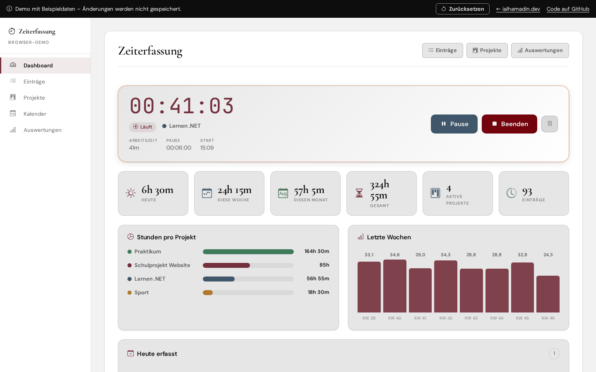
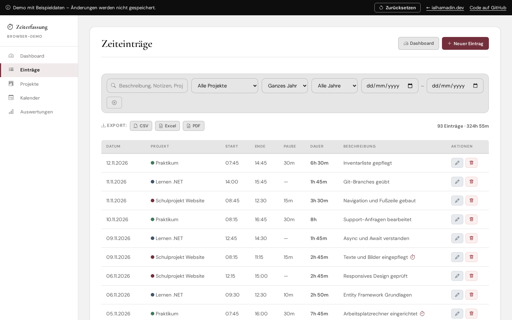
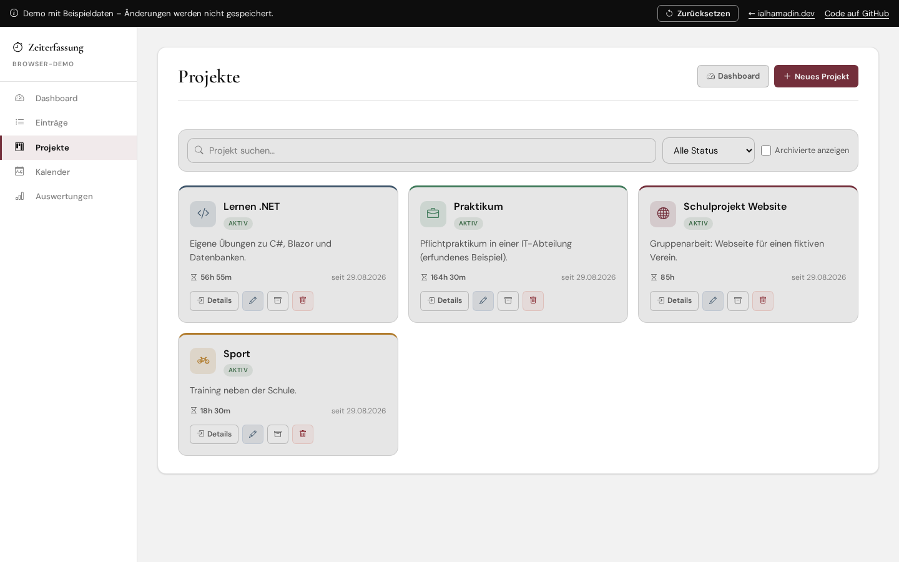
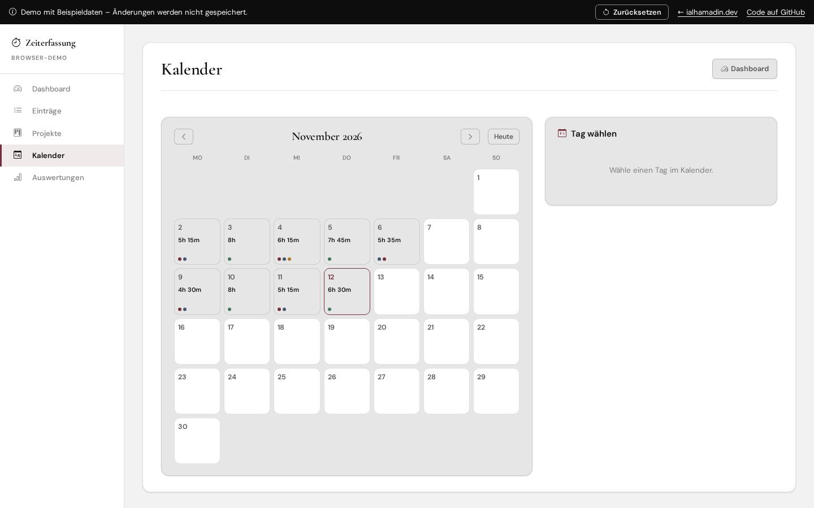
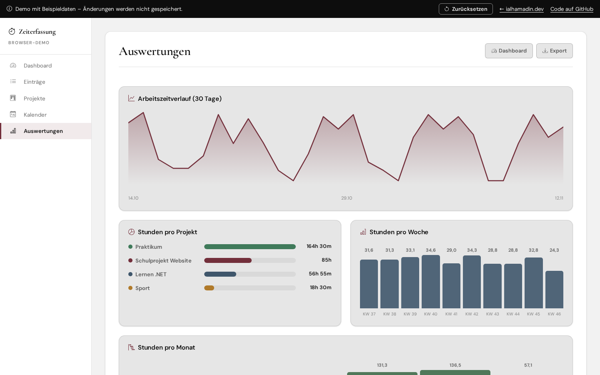

# Zeiterfassung

[English below](#english)

Zeiterfassung ist eine kleine App, mit der man Arbeitszeiten erfasst: per Live-Timer oder als nachträglicher Eintrag, sortiert nach Projekten. Dazu gibt es Kalender, Auswertungen und CSV-Export. Sie ist als **Browser-Demo** gebaut: Alles läuft in deinem Browser, es gibt keinen Server, kein Login und keine Datenbank. Die Beispieldaten sind frei erfunden.

> **Demo mit Beispieldaten.** Änderungen bleiben nur im Browser und sind nach dem Neuladen weg.

**Live-Demo:** <https://ialhamadin.dev/demos/zeiterfassung/>

## Funktionen

- **Live-Timer** mit Start, Pause, Fortsetzen und Beenden. Beim Beenden entsteht ein Zeiteintrag.
- **Zeiteinträge** anlegen, bearbeiten und löschen; Suche und Filter nach Projekt, Monat, Jahr und Zeitraum.
- **Projekte** mit Farbe und Symbol, archivieren oder abschließen; Detailseite je Projekt.
- **Kalender** mit Tagessummen und Projektfarben.
- **Auswertungen:** Stunden pro Projekt, pro Woche, pro Monat und als Tagesverlauf (eigene, leichte Diagramme ohne Zusatzbibliothek).
- **CSV-Export** der gefilterten Einträge, direkt im Browser erzeugt.

## Stack

- .NET 10, Blazor WebAssembly
- Entity Framework Core mit dem InMemory-Provider (die „Datenbank“ liegt im Speicher des Browsers)
- Beispieldaten werden beim Start relativ zu „heute“ erzeugt, damit die Demo nie veraltet
- nginx liefert die gebaute App aus (Docker)
- Tests: xUnit

## Screenshots

| | |
|---|---|
|  |  |
|  |  |
|  | |

## Starten

Mit Docker (kein .NET nötig):

```bash
docker compose up
```

Danach im Browser <http://localhost:8080> öffnen. Einen anderen Port stellst du mit `DEMO_PORT` ein (siehe `.env.example`).

## Entwickeln

Mit dem .NET 10 SDK:

```bash
dotnet run --project src/Zeiterfassung.Web
dotnet test
```

Hinweise:

- Die App läuft standardmäßig unter `/`. Für einen Unterpfad (z. B. `/demos/zeiterfassung/`) setzt `docker/set-base-path.sh <Ordner> <Basispfad>` nach dem Veröffentlichen den Basispfad in `index.html`.
- `docker/headers.inc` enthält eine Content-Security-Policy, die jede Verbindung nach außen sperrt (`connect-src 'self'`). Inline-Skripte sind erlaubt, weil `index.html` die Importmap mit den Dateihashes inline enthält (sie ändert sich mit jedem Build).

## Was in der Demo anders ist

- Keine Anmeldung, kein Benutzer, keine Rollen: Es gibt einen lokalen Benutzer.
- Die Daten liegen nur im Speicher. „Zurücksetzen“ im Band oben lädt die Beispieldaten neu.
- Export nur als CSV; Excel und PDF sind in der Demo deaktiviert.

## Drittanbieter

Schriften (Cormorant Garamond, DM Sans, JetBrains Mono; SIL Open Font License) und Bootstrap Icons (MIT) liegen unter `src/Zeiterfassung.Web/wwwroot/fonts/` mit ihren Lizenztexten und werden selbst ausgeliefert. Die Demo lädt nichts von fremden Servern.

## Lizenz

MIT, siehe [LICENSE](LICENSE).

---

# English

Zeiterfassung ("time tracking") is a small app for logging working hours: with a live timer or as manual entries, grouped by project. It also has a calendar, reports and CSV export. It is built as a **browser demo**: everything runs in your browser, with no server, no login and no database. All sample data is made up.

> **Demo with sample data.** Changes stay in the browser and are gone after a reload.

**Live demo:** <https://ialhamadin.dev/demos/zeiterfassung/>

## Features

- **Live timer** with start, pause, resume and stop. Stopping creates a time entry.
- **Time entries**: create, edit and delete; search and filter by project, month, year and date range.
- **Projects** with colour and icon, archive or complete them; a detail page per project.
- **Calendar** with daily totals and project colours.
- **Reports:** hours per project, per week, per month and as a daily trend (small built-in charts, no extra chart library).
- **CSV export** of the filtered entries, generated in the browser.

## Stack

- .NET 10, Blazor WebAssembly
- Entity Framework Core with the InMemory provider (the "database" lives in the browser's memory)
- Sample data is generated at start-up relative to "today", so the demo never goes stale
- nginx serves the built app (Docker)
- Tests: xUnit

## Screenshots

See the table in the German section above.

## Run it

With Docker (no .NET needed):

```bash
docker compose up
```

Then open <http://localhost:8080>. Use `DEMO_PORT` to pick another port (see `.env.example`).

## Develop

With the .NET 10 SDK:

```bash
dotnet run --project src/Zeiterfassung.Web
dotnet test
```

Notes:

- The app runs at `/` by default. To serve it under a sub-path (for example `/demos/zeiterfassung/`), run `docker/set-base-path.sh <folder> <base path>` on the published output; it sets the base path in `index.html`.
- `docker/headers.inc` contains a Content-Security-Policy that blocks every outgoing connection (`connect-src 'self'`). Inline scripts are allowed because `index.html` contains the import map with the file hashes inline (it changes with every build).

## What is different in the demo

- No sign-in, no users, no roles: there is one local user.
- Data lives in memory only. "Zurücksetzen" (reset) in the top bar reloads the sample data.
- Export is CSV only; Excel and PDF are disabled in the demo.

## Third-party

Fonts (Cormorant Garamond, DM Sans, JetBrains Mono; SIL Open Font License) and Bootstrap Icons (MIT) are in `src/Zeiterfassung.Web/wwwroot/fonts/` with their licence texts and are served locally. The demo loads nothing from third-party servers.

## License

MIT, see [LICENSE](LICENSE).
